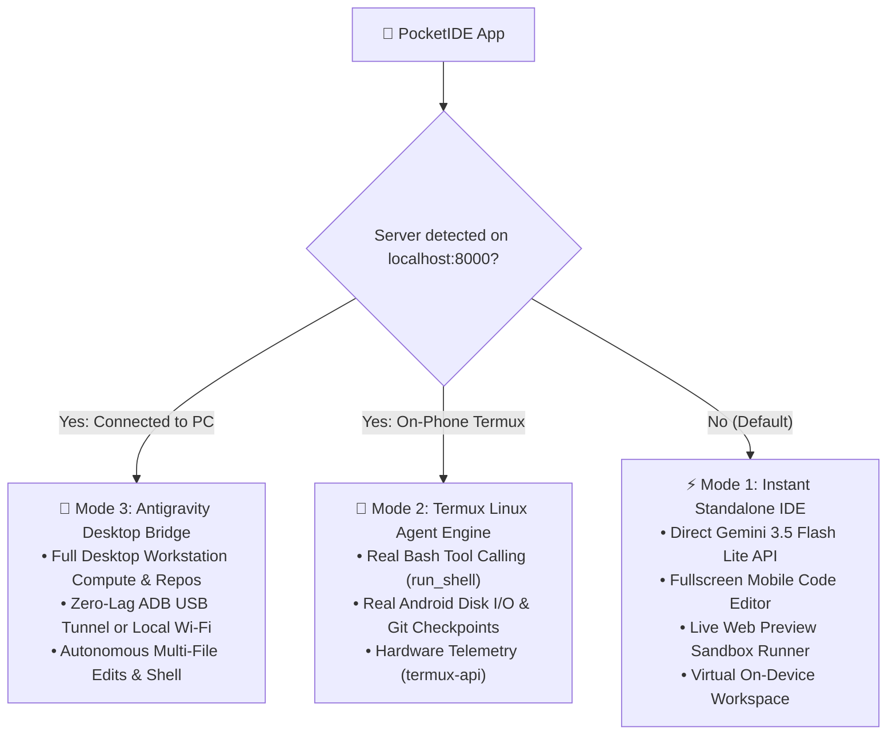

# ✦ PocketIDE

<div align="center">

[](https://github.com/manansheth296-tech/Antigravity-Mobile/releases/latest)
[](https://github.com/manansheth296-tech/Antigravity-Mobile)
[](https://aistudio.google.com/)
[](LICENSE)
[](https://github.com/manansheth296-tech/Antigravity-Mobile/actions)

<br/>

### **Autonomous Agentic AI Software Engineering IDE for Android**

*Write code, preview web apps live, execute Linux commands, and code hands-free with voice — all from your phone.*

<br/>

<a href="https://github.com/manansheth296-tech/Antigravity-Mobile/releases/download/v1.0.0/PocketIDE.apk">
  
</a>

<br/><br/>

</div>

---

## 🌟 What is PocketIDE?

**PocketIDE** transforms any Android smartphone into an autonomous software development workstation. Powered by Google Gemini 3.5 Flash Lite, it delivers sub-2.5s AI code generation, a full-featured mobile code editor, an instant web preview sandbox, and optional Linux terminal tool execution.

Whether you want to sketch an HTML5 game on the bus, debug a Python script from your couch, or float an AI companion over Termux, PocketIDE is built for pocket productivity.

---

## 🚀 Choose Your Mode

PocketIDE is engineered with a **Tri-Mode Flexible Architecture**. You can run it in three distinct ways:



### 📱 Mode 1: Instant Standalone IDE (Zero Setup — For Everyone)
- **No Linux or terminal knowledge required!** Just install the APK and start coding.
- **Direct Gemini Engine:** Direct client-side HTTPS connection to Google Gemini (`gemini-3.5-flash-lite`).
- **Fullscreen Mobile Code Editor:** Line gutter, syntax highlighting, search/replace, and the **Mobile Coding Symbols Ribbon** (`Tab`, `{ }`, `( )`, `[ ]`, `" "`, `' '`, `=`, `;`, `:`, `>`, `<`, `/`, `\`, `!`, `$`, `#`, `_`) for rapid mobile typing.
- **Live Web Preview Runner:** Sandboxed `<iframe>` runner that renders HTML5, Canvas, and JavaScript live on device with a slide-up **Virtual DevTools Console**.
- **1-Click Starter Templates:** Scaffolds ready-to-run touch arcade games, notes PWAs, telemetry dashboards, and FastAPI services in 1 tap.
- **100% Bundled Offline Runtime:** Zero external CDN dependencies—Prism.js and Marked.js are bundled inside the APK.

### 🐧 Mode 2: Autonomous Linux Agent Engine (On-Phone Power Users)
- **Autonomous Tool Calling:** The AI autonomously runs real bash commands (`run_shell`), reads/writes disk files (`read_file`, `write_file`, `patch_file`), and commits git checkpoints (`git_checkpoint`) right inside Termux on Android.
- **Interactive Tool Execution Cards:** Streams real-time tool execution cards directly into the mobile chat with live status badges (`RUNNING`, `SUCCESS`, `ERROR`) and terminal outputs.
- **100% Python Standard Library:** Zero compiled C/Rust dependencies—runs natively on 32-bit (`armeabi-v7a`) and 64-bit (`arm64-v8a`) Android devices.

### 🌌 Mode 3: Desktop Hub & Antigravity IDE Bridge (Main PC Workstation)
- **Centralized Workstation Compute:** Your main PC workstation running **Google Antigravity** acts as the central compute powerhouse, while your phone acts as the mobile companion and voice controller.
- **Full Desktop Codebase Access:** Browse, search, and edit full multi-gigabyte PC repositories, run Docker containers, execute tests, and trigger heavy builds directly from your phone.
- **Bidirectional Live Synchronization:** Changes made on your phone instantly reflect in your Antigravity desktop IDE, and desktop file edits are immediately accessible on mobile.

---

## 🎙️ Voice-Driven Coding & Floating Companion (PiP)

PocketIDE is designed for fluid, hands-free coding:

- **Animated Audio Waveform HUD:** Tap the mic button to open the glowing concentric-ring audio HUD with live speech transcription.
- **Smart Voice Developer Commands:** Speak common development actions directly:
  - `"Run shell git status"` &rarr; Runs bash command in Termux workspace.
  - `"Run tests"` &rarr; Executes test suite automatically.
  - `"Explain code"` &rarr; Analyzes the file open in the mobile editor.
  - `"Find bugs"` &rarr; Scans the active file for bugs and security flaws.
  - `"Live preview"` &rarr; Instantly launches the web preview sandbox.
  - `"Clear chat"` &rarr; Resets conversation history.
- **Spoken Audio Responses (TTS `🔊`):** Toggle speech audio to hear crisp 1-sentence summaries of what the AI built or executed.
- **⧉ Picture-in-Picture Floating Companion:** Tap the PiP button in the header (or swipe up to home) to shrink PocketIDE into a compact floating companion window that stays on top of Termux, Chrome, or any other app.

---

## 📥 Quick Start Guide

### Step 1: Install the Android App
1. Download **[PocketIDE.apk](https://github.com/manansheth296-tech/Antigravity-Mobile/releases/download/v1.0.0/PocketIDE.apk)** to your Android phone.
2. Open the downloaded file and select **Install** (allow *Install from Unknown Sources* if prompted).
3. Open **PocketIDE** from your app drawer.

### Step 2: Activate Free AI Key (30 Seconds)
1. Get a free Gemini API key from [Google AI Studio](https://aistudio.google.com/app/apikey) (generous free daily quota, no credit card required).
2. Paste your key into the **Instant Setup** box on the home screen and tap **Activate ✦**.
3. You're ready to code!

*(Optional: You can also tap **"▶ Run Live Web Preview"** immediately to play the built-in touch arcade game before even entering an API key!)*

---

## 🐧 Optional: Setup Autonomous Termux Linux Agent

If you want the AI to run real bash commands and edit disk files on Android:

1. Install **Termux** from [F-Droid](https://f-droid.org/en/packages/com.termux/) or [GitHub Releases](https://github.com/termux/termux-app/releases).
2. Open Termux and run this single setup command:
   ```bash
   curl -sL https://raw.githubusercontent.com/manansheth296-tech/Antigravity-Mobile/main/termux_setup.sh | bash
   ```
3. Start the agent daemon:
   ```bash
   cd ~/pocketide && ./start_termux.sh
   ```
4. Re-open **PocketIDE**. The app will detect the server and show **`● Termux (3.5-flash-lite)`**!

---

## 🌌 Connecting to Google Antigravity (Desktop Hub & Workstation Bridge)

PocketIDE acts as a dedicated mobile companion for your primary workstation running **Google Antigravity** (or any desktop IDE). When connected, you can browse desktop projects, run autonomous tool calling against your PC's disk, and code from your phone while your PC handles heavy compute:

### Connection Method 1: USB Cable (ADB Reverse Tunnel — Recommended)
This gives you zero-latency, reliable connectivity with no Wi-Fi network dependency:

1. Connect your Android phone to your PC via USB (with USB Debugging enabled).
2. On your PC, navigate to your Antigravity project workspace and start the agent:
   ```bash
   python run.py
   ```
3. Set up the USB reverse port tunnel:
   ```bash
   adb reverse tcp:8000 tcp:8000
   ```
   *(Or run the included daemon `python backend/adb_tunnel.py` to keep the connection automatically alive).*
4. Open **PocketIDE** on your phone. The app will immediately link with your PC's workspace and display `● Termux (3.5-flash-lite)` (or `● Desktop Bridge`), giving you live access to all your PC workspace files!

### Connection Method 2: Local Wi-Fi Network / Tailscale VPN
If you want to walk around your house or office completely wireless:

1. Start the agent server on your PC:
   ```bash
   python run.py
   ```
2. Note your PC's local network IP address (e.g. `192.168.1.50`) or Tailscale IP.
3. In PocketIDE, enter your workstation address (e.g. `http://192.168.1.50:8000`) in settings.

### Switching Workspaces on Your PC
By default, the server serves the current directory. You can expose any project folder on your PC to your phone by setting the `POCKETIDE_WORKSPACE` environment variable:
```bash
# Windows PowerShell
$env:POCKETIDE_WORKSPACE = "M:\Dev"
python run.py

# Linux / macOS
export POCKETIDE_WORKSPACE="/path/to/projects"
python run.py
```

---

## 🎨 Starter Project Templates Gallery

PocketIDE includes 1-click scaffolding templates pre-configured for mobile development:

| Template | Description | Technology |
|---|---|---|
| 🎮 **Neon Arcade Touch Game** | 60fps Canvas physics game with virtual touch controls & particle explosions | HTML5 Canvas, JS |
| 📱 **Obsidian Mobile Notes PWA** | Offline markdown notes manager with localStorage persistence | HTML5, CSS3, JS |
| 📊 **Real-time Telemetry Dashboard** | Live multi-metric telemetry charts with smooth canvas animations | Canvas API, JS |
| 🐍 **Termux Hardware Telemetry Script** | Inspects battery, sensors, and triggers Android haptic vibrations | Python 3, Termux API |
| ⚡ **FastAPI Microservice Boilerplate** | Production REST API boilerplate with health probes and schemas | Python 3, FastAPI |

---

## 📱 Hardware & OS Compatibility

PocketIDE is verified and optimized for a wide range of Android hardware:

- **Operating System:** Android 8.0 (Oreo, API 26) through Android 14+ (API 34+).
- **Tested Devices:**
  - Samsung Galaxy F13 (`SM-E135F`, Android 14 / One UI Core 6.1, 32-bit `armeabi-v7a`)
  - Samsung Galaxy M02s (Android 12, 64-bit `arm64-v8a`)
  - Xiaomi & Redmi series (MIUI / HyperOS)
  - Google Pixel series (Stock Android)
- **Architecture Compatibility:** `arm64-v8a`, `armeabi-v7a`, `x86`, `x86_64`.
- **Zero Local Android Compilation Required:** Fully self-contained.

---

## 🔒 Privacy & Security

- **Direct Connections:** In Standalone mode, your phone communicates directly with Google's Gemini API over TLS 1.3 HTTPS. No intermediary analytics or tracking servers exist.
- **Local Storage:** Your API keys and workspace files are stored exclusively inside your phone's sandboxed `localStorage` / private app storage.
- **Termux Sandboxing:** In Termux mode, bash executions are restricted to the Android userspace sandbox (`com.termux`).

---

## 🛠️ Automated Cloud CI/CD

Every push to `main` triggers a GitHub Actions workflow ([`.github/workflows/build-apk.yml`](.github/workflows/build-apk.yml)) that:
1. Sets up JDK 17 and Android SDK 34.
2. Compiles a production-ready Debug APK with Gradle.
3. Automatically publishes the compiled binary to [GitHub Releases](https://github.com/manansheth296-tech/Antigravity-Mobile/releases).

---

## 🤝 Contributing

Contributions are warmly welcomed! Please read [CONTRIBUTING.md](CONTRIBUTING.md) to get started.

1. Fork the repo.
2. Create a feature branch (`git checkout -b feature/cool-feature`).
3. Commit your changes (`git commit -m "feat: Add cool feature"`).
4. Push to GitHub (`git push origin feature/cool-feature`).
5. Open a Pull Request!

---

## 📄 License

This project is licensed under the **MIT License** — see the [LICENSE](LICENSE) file for details.

---

<div align="center">

**Built with ✦ for mobile developers worldwide.**

</div>
